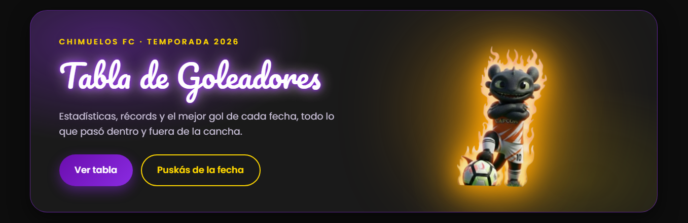
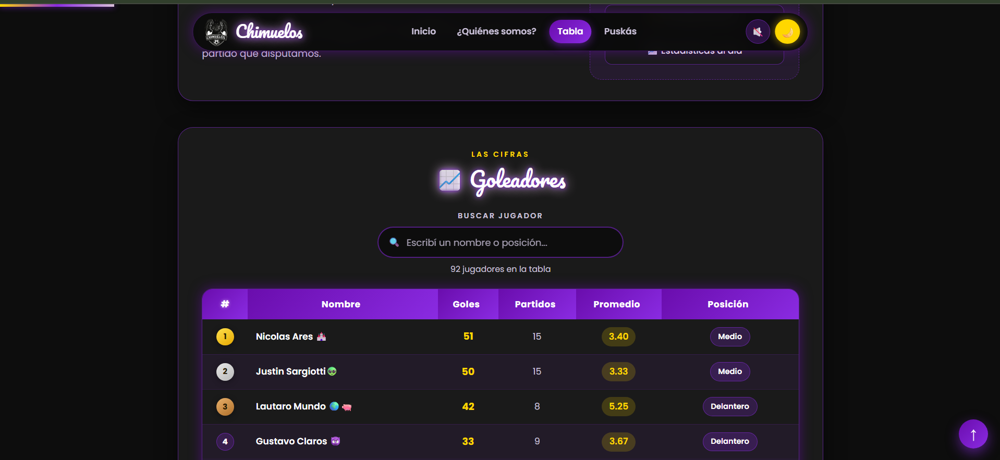
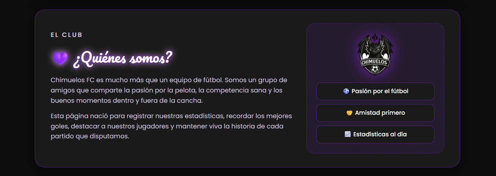

# Tabla de Goleadores - Chimuelos FC

Página para registrar y mostrar las estadísticas de goles del **Chimuelos FC**: la tabla de goleadores, el Puskás de la fecha, el buscador de jugadores y la información del equipo.

## Descripción

Chimuelos FC es un grupo de amigos que juega al fútbol y quería dejar registro de sus números. Esta página carga los datos desde una planilla de Excel (`Tabla Unificada.xlsx`) y muestra:

- Tabla de goleadores con puesto, goles, partidos, promedio y posición en la cancha.
- Ordenamiento por columnas (tocando los encabezados).
- Buscador en vivo de jugadores por nombre o posición.
- Medallas para los tres primeros puestos.
- Puskás de la fecha con video del mejor gol.
- Modo claro/oscuro, navbar responsive y barra de progreso de scroll.

## Capturas







## Tecnologías

- HTML
- CSS
- JavaScript (vanilla)
- [SheetJS (xlsx)](https://cdnjs.com/libraries/xlsx) para leer la planilla
- GSAP para animaciones de la mascota

## Cómo correrlo

La página necesita un servidor local porque el Excel se lee con `fetch`.

```bash
# opción con Python
python -m http.server 8000
```

Y después abrir `http://localhost:8000`. También podés usar la extensión Live Server de VS Code.

> Nota: abrir `index.html` directo desde el explorador de archivos puede fallar la carga del Excel.